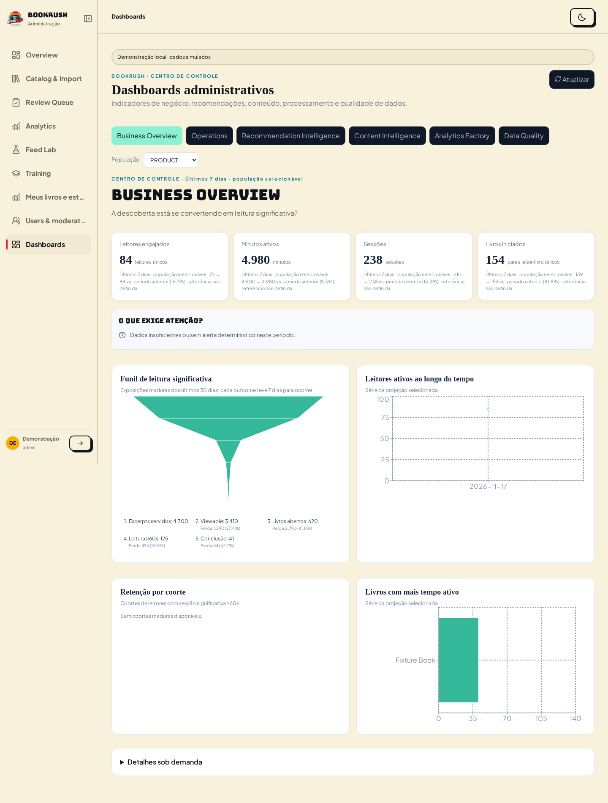
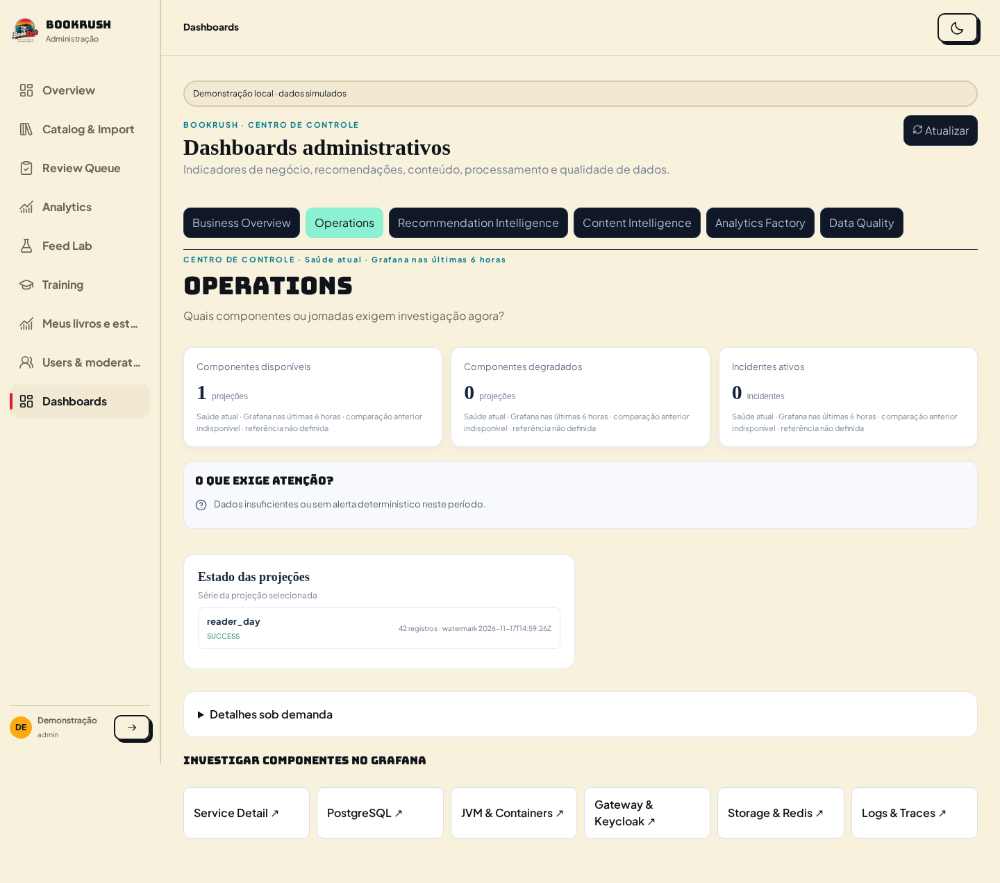
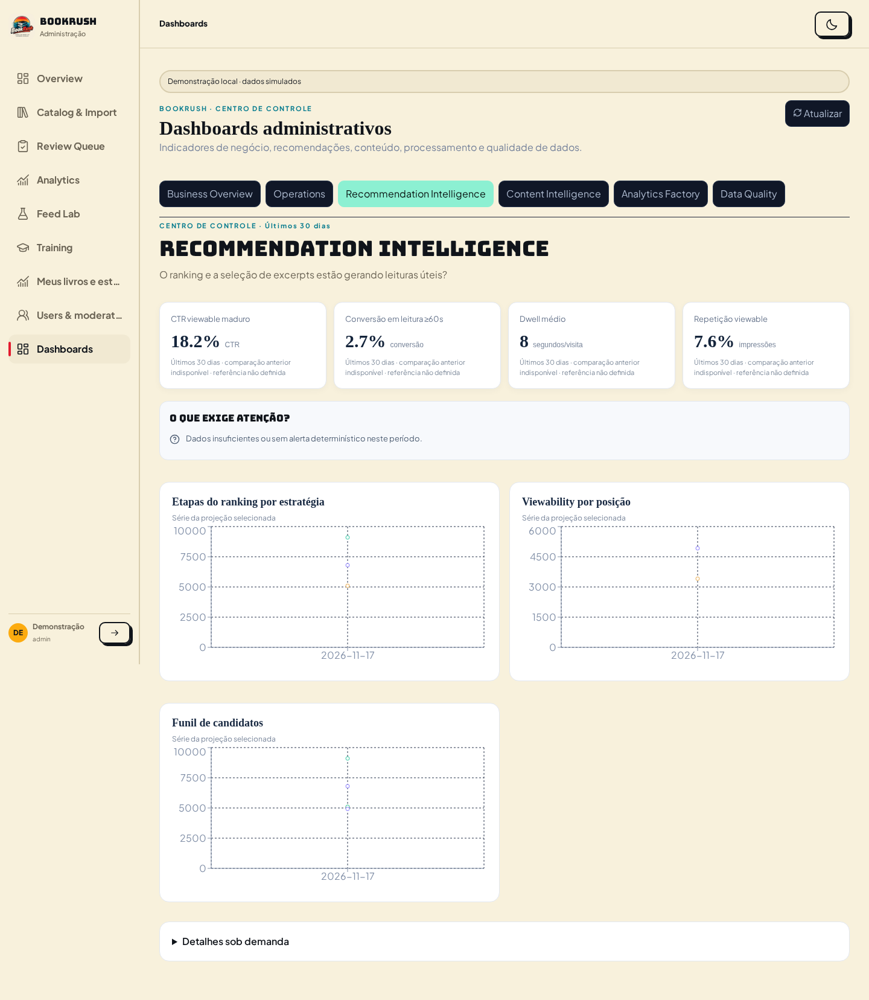
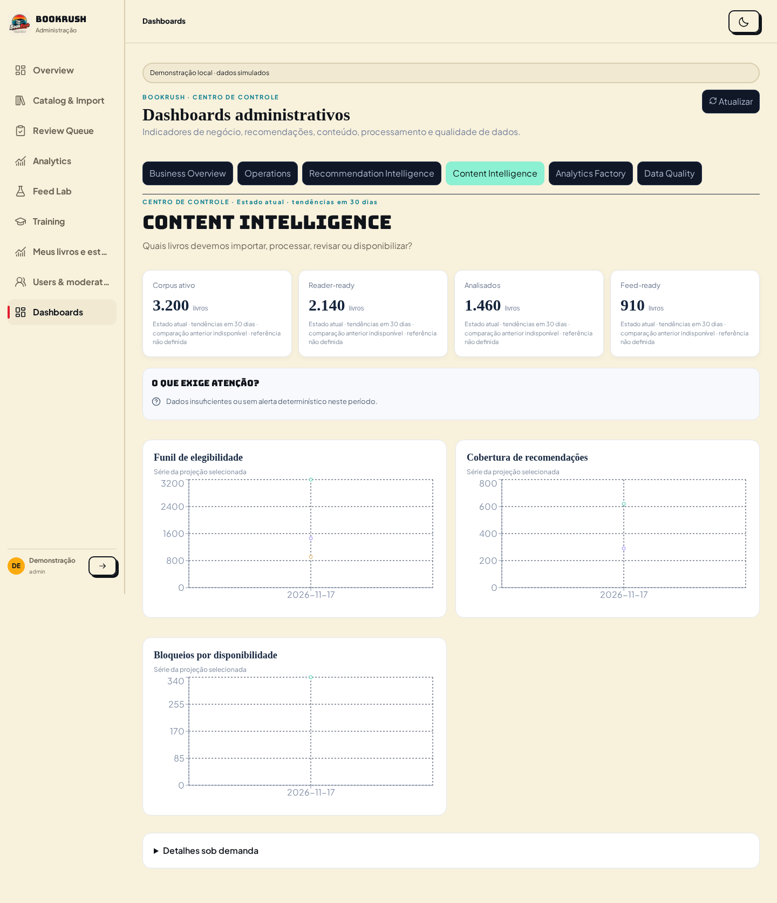
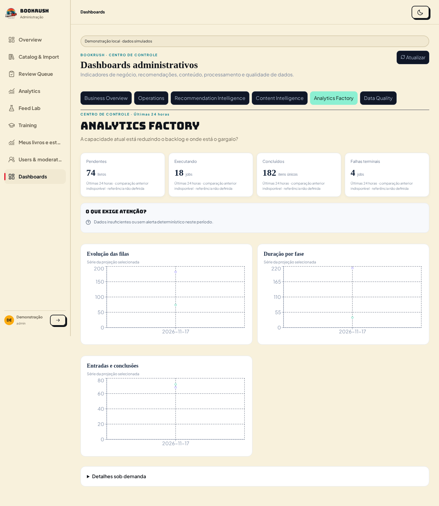
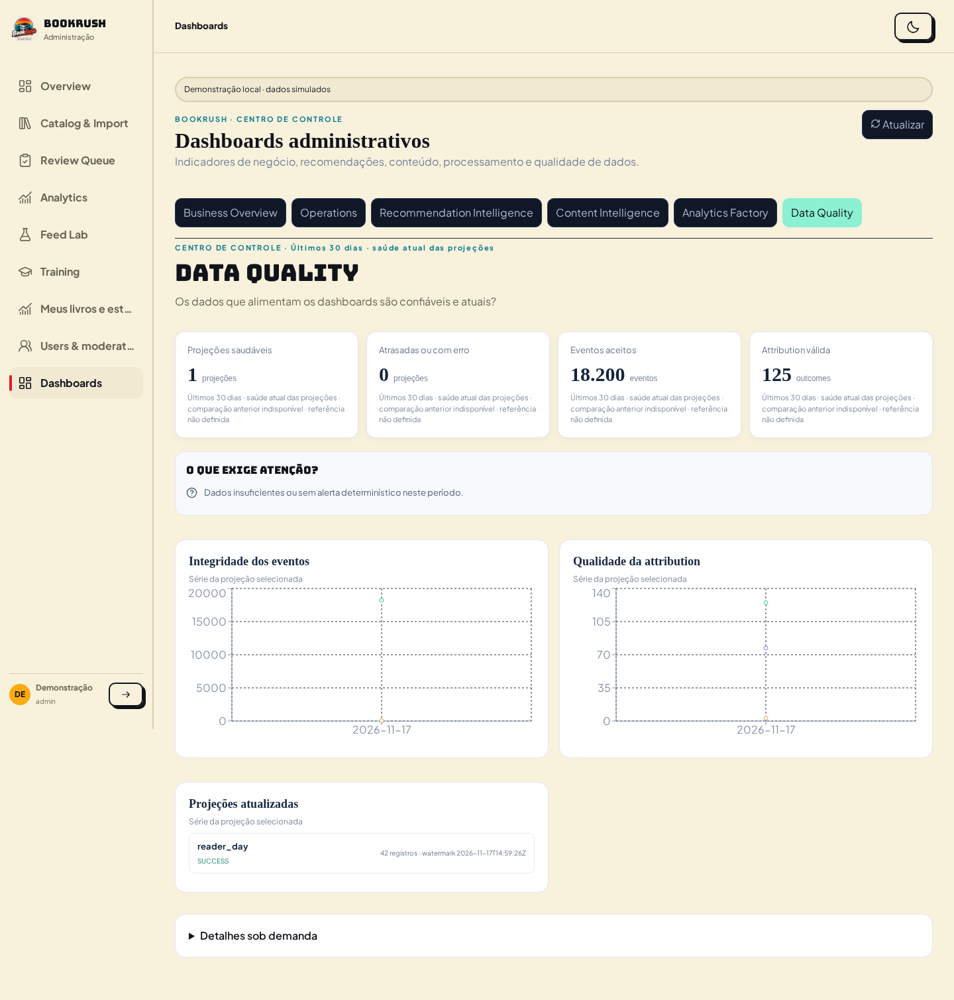

# Dashboard Redesign V2 — evidências

As seis páginas foram abertas com fixtures determinísticas e verificadas quanto ao carregamento sob demanda. O aviso de demonstração visível nas capturas identifica os dados simulados.

| Área | Captura |
|---|---|
| Business Overview |  |
| Operations |  |
| Recommendation Intelligence |  |
| Content Intelligence |  |
| Analytics Factory |  |
| Data Quality |  |

## Validação executada

- Build e testes de unidade do Admin Web.
- E2E de navegação nas seis áreas, assertions de requests por aba e capturas.
- Testes focados dos controllers de admin e behavior.
- Flyway em PostgreSQL 16 descartável: migrations behavior até V13 e admin até V55 aplicadas; colunas/chaves verificadas e serviços iniciados com a base de validação.
- Parse de OpenAPI YAML, JSONs Grafana e UIDs únicos.

## Lacunas de runtime e indicadores

- Os gráficos de Operations no Grafana foram provisionados sobre métricas existentes, mas não foram consultados num datasource/deploy real; a matriz sintética funcional ainda depende de executar periodicamente os smokes sem afetar PRODUCT.
- O endpoint Admin de saúde não agrega 5xx, latência, throughput ou saturação; o hub exibe saúde das projeções e liga aos dashboards técnicos Grafana.
- Dwell mediano, comparação por experimento, vínculo de feature analítica versionada a outcome, oportunidades editoriais por livro e composição por gênero não têm fonte consolidada verificável.
- ETA/capacidade e jobs parados por heartbeat/progresso dependem de campos ainda não expostos em todas as fontes; o insight de workers usa apenas `stuck_count` consolidado quando disponível.
- O funil de negócio usa outcomes maduros de sete dias e população selecionada. Coortes únicos comparáveis para todas as etapas, atribuição de leitura por posição e regra única de elegibilidade do catálogo exigem validação de dados integrada.
- Histórico sem origem autenticada permanece `UNKNOWN`. As migrations passaram em PostgreSQL isolado; o refresh dos read models do Admin não foi exercitado porque o banco descartável não contém os schemas dos serviços vizinhos. Não houve deploy nem smoke autenticado pelo gateway nesta branch.

Durante o teste de startup de behavior foi detectada uma colisão preexistente entre duas rotas S2S iguais. A rota agregada com limiar foi movida para `/summary`; a rota diária consumida pelo Publisher manteve o caminho original.

As capturas não são evidência de produção. Elas demonstram a hierarquia visual, estados de dados e navegação com fixtures.
