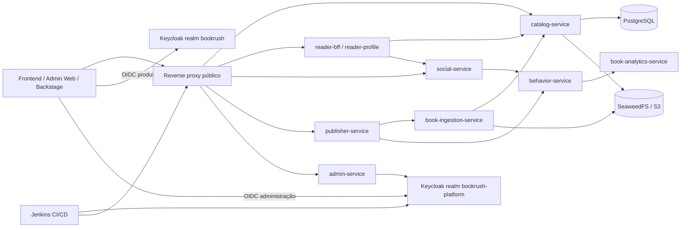

# Guia da plataforma BookRush

Este é o mapa operacional da plataforma. Ele explica como os serviços se
relacionam, como a identidade atravessa o sistema e como uma alteração chega
ao ambiente. O código, os arquivos de configuração e as migrations continuam
sendo a fonte de verdade; este documento reúne as decisões e os caminhos para
encontrá-los.

## Como ler este guia

| Preciso entender... | Começo por... |
| --- | --- |
| Um serviço ou uma rota | Catálogo do Backstage, OpenAPI do serviço e tabela de serviços abaixo |
| Login, 401 ou 403 | [Segurança](security.md), matriz de realms e checklist de autorização |
| Fazer build/deploy | [Operação](operations.md), [Validação](validation.md) e os runbooks versionados em `docs/operations/` |
| Alterar banco | `services/*/src/main/resources/db/migration/` e checklist de migrations |
| Registrar uma nova integração | [Integrar serviços](onboarding.md) e [TechDocs, APIs e ADRs](documentation.md) |
| Reproduzir uma validação | [Validação](validation.md) e [resultados reproduzíveis](validation-results.md) |

## Visão geral

O reverse proxy é o caminho de validação de produção. Uma chamada interna ao
container prova conectividade, mas não prova DNS, TLS, CORS, issuer, audience,
cookies ou roteamento público.

## Entregas já incorporadas

As seguintes fundações já fazem parte da plataforma e devem ser tratadas como
contratos existentes, não como mocks a serem recriados no frontend:

- `admin-service` expõe KPIs, auditoria, reports, usuários e moderação com
  autorização no realm de plataforma e integração declarativa com a API de
  administração do Keycloak.
- `social-service` mantém likes, follows, comentários, shares e reports no
  banco; a UI deve consultar esses dados e não reconstruir contadores a partir
  de estado local.
- `publisher-service` modela submissões, membros, upload, review, withdraw e
  métricas, chamando ingestão por contrato autenticado.
- `behavior-service` persiste eventos e outbox, com entrega idempotente ao
  analytics; falhas transitórias não transformam um evento já aceito em
  duplicata.
- O frontend principal, o `admin-web` e o Backstage possuem pipelines próprias
  e cobertura/builds separados. O deploy principal não substitui o deploy do
  console nem o build do portal.
- A busca, o leitor EPUB/HTML, thumbnails protegidas e a fila de review usam
  APIs autenticadas e preservam a estrutura do conteúdo. Converter o livro
  inteiro para TXT não é uma alternativa compatível com navegação por capítulo.
- Keycloak, Jenkins, SeaweedFS e o stack Compose têm configuração declarativa,
  testes descartáveis e preservação explícita de volumes/usuários.

Essas entregas não significam que todos os gates de produto estão fechados.
Pilotos humanos, datasets rotulados, carga, modelos de analytics e cenários
E2E específicos continuam sendo acompanhados pelos beads correspondentes.

## Identidade e autorização

Há dois realms deliberadamente separados:

| Realm | Uso | Clientes principais | Audience típica |
| --- | --- | --- | --- |
| `bookrush` | Usuários do produto e leitura/social | `bookrush-web` | `account` e scopes de produto |
| `bookrush-platform` | Administração, publicação, ingestão e automação | `labsoft-admin-web`, `bookrush-jenkins`, `bookrush-admin-service` | `bookrush-ingestion` ou audience específica do serviço |

### Regras que evitam os erros recorrentes

1. `iss` precisa ser exatamente o issuer configurado no serviço. Um token do
   realm de produto não autentica uma rota de plataforma apenas porque o
   usuário pertence aos mesmos grupos.
2. `aud` é a audience do serviço; `azp` é o cliente que solicitou o token e
   não o substitui.
3. `401` indica ausência, expiração, assinatura, issuer ou audience inválidos.
   `403` indica token válido sem a autoridade necessária, origem CORS não
   autorizada ou política de acesso negada.
4. Toda alteração de cliente, role, scope ou mapper deve ser declarativa em
   `infrastructure/keycloak/*.json` e aplicada pelo reconcile idempotente.
5. O usuário persistente `codex-jenkins-agent` pertence ao realm de plataforma
   e aos grupos operacionais necessários. Ele não é um usuário do produto nem
   deve ser usado para validar fluxos de leitura/social.
6. O cliente `bookrush-jenkins` emite `aud=bookrush-ingestion` e uma claim
   `sub`. A claim `sub` é importante: o Spring pode aceitar a assinatura do
   JWT, mas endpoints que dependem da identidade do principal falham se ela não
   estiver disponível.
7. O cliente `bookrush-admin-service` usa credencial de serviço com escopo
   mínimo para consultar/gerenciar usuários. O segredo existe somente no
   ambiente protegido.

Nunca registre neste portal senha, client secret, bearer token, cookie, crumb,
authorization code ou conteúdo de `.env`. Para investigar claims, registre
somente `iss`, `aud`, `azp`, `scope`, `exp` e grupos, sem imprimir o token.

## Matriz de serviços

Os nomes abaixo são os contratos de domínio. O catálogo e o Compose são a
fonte para portas, imagens e dependências efetivas.

| Serviço | Responsabilidade | Identidade | Persistência/integrações |
| --- | --- | --- | --- |
| `catalog-service` | Livros, edições, capítulos, assets, thumbnails e busca | Produto para leitura; plataforma nas rotas administrativas | PostgreSQL, SeaweedFS/S3, Flyway |
| `book-ingestion-service` | Importação Gutenberg, staging, proveniência, reprocessamento e recuperação | Plataforma / `bookrush-ingestion` | PostgreSQL, SeaweedFS, catálogo |
| `reader-bff-service` | Agregação das leituras, biblioteca, capítulos e ações do leitor | Produto | Catálogo, social, perfil e behavior |
| `reader-profile-service` | Perfil, biblioteca e progresso | Produto | PostgreSQL |
| `social-service` | Likes, follows, comentários, compartilhamentos e moderação | Produto; moderação protegida | PostgreSQL, behavior |
| `publisher-service` | Submissões, membros, upload, revisão e métricas de publisher | Plataforma / `bookrush-ingestion` | PostgreSQL, catálogo, ingestão, behavior |
| `admin-service` | KPIs, usuários, auditoria, reports e administração | Plataforma / roles administrativas | PostgreSQL, Keycloak Management API |
| `behavior-service` | Eventos comportamentais e agregados | Produto para eventos do usuário | PostgreSQL e outbox HTTP |
| `book-analytics-service` | Métricas, analytics de conteúdo, QA/EQL e sink comportamental | Plataforma para operações internas | PostgreSQL, storage de modelos e sink |
| `recommendation-service` | Feed heuristic-v1, ledger de requests/impressions e viewability | Produto | Catálogo, PostgreSQL |
| `frontend` | Aplicação leitora e biblioteca | `bookrush-web` | APIs públicas via gateway |
| `admin-web` | Console de review, administração e operação | `labsoft-admin-web` | APIs administrativas via gateway |
| `developer-portal` | Catálogo, API docs e TechDocs | OIDC Backstage separado | PostgreSQL do Backstage, publisher TechDocs |

### Fluxos importantes

**Importação Gutenberg:** ingestão cria ou localiza a identidade do livro,
registra origem e revisão, grava EPUB/HTML/TXT/JSON e thumbnail no storage,
processa assets de forma idempotente e deixa o conteúdo sujeito ao estado de
review. Reprocessar não deve criar outro livro.

**Review:** o admin consulta a fila, abre o asset pelo endpoint autenticado
adequado ao tipo (EPUB, imagem, HTML, JSON ou texto), aprova/rejeita livro e
thumbnail e pode revogar uma aprovação. O histórico é a evidência para
corrigir um miss click; aprovação não deve ser feita alterando banco à mão.

**Leitura:** o frontend usa o cliente autenticado. Para imagens protegidas,
busca o blob com bearer em memória e cria uma Object URL; `img src` cru não
carrega automaticamente o token. O leitor preserva a estrutura EPUB/HTML para
sumário e capítulos, em vez de tratar o livro inteiro como TXT plano.

**Comportamento:** social, reader e publisher emitem eventos com idempotência.
O behavior-service persiste o evento e a outbox; o dispatcher entrega ao sink
de analytics. O evento pode ser reenviado sem duplicar pelo seu identificador.

## CORS e chamadas do navegador

CORS é parte do contrato da rota. Cada serviço deve listar explicitamente as
origens reais no ambiente, permitir os métodos usados e aceitar os cabeçalhos
necessários, incluindo `Authorization`, `Content-Type`, `X-Admin-Client` e
`Idempotency-Key` quando aplicável.

O preflight precisa ser testado com a origem real e com o mesmo método e
headers da chamada. Uma falha de `OPTIONS` costuma aparecer no navegador como
`NetworkError`, embora o problema esteja no gateway ou na API. Não usar `*`
com APIs autenticadas.

## Jenkins: do commit ao container

### Ordem segura

1. Criar/assumir o bead e ler o checklist obrigatório.
2. Rodar testes locais e publicar a branch remota. Jenkins nunca executa uma
   alteração que existe apenas no workspace local.
3. Abrir uma sessão OIDC nova no Jenkins usando o usuário persistente
   `codex-jenkins-agent`.
4. Confirmar `whoAmI` autenticado e com `platform-operators`.
5. Obter o crumb na mesma sessão/cookie jar.
6. Disparar o job correto e informar a branch exata.
7. Para atualizar Compose, usar `DEPLOY=true` e
   `DEPLOY_TARGET=compose`. `PUBLISH=true` apenas publica a imagem.
8. Acompanhar fila e build até `building=false` e `result=SUCCESS`.
9. Conferir a imagem/digest efetivo, healthcheck e logs do container.
10. Executar smoke pelo gateway público com token novo e CORS real.

### Escolha do job

| Objetivo | Job |
| --- | --- |
| Stack integrado | `bookrush-deploy` |
| Serviço isolado | `bookrush-microservice-<service>` |
| Vertical | `bookrush-vertical-<vertical>` |
| Console administrativo | `bookrush-admin-web` |
| Portal/TechDocs | `bookrush-backstage` |
| Storage | `bookrush-seaweedfs` |

Jobs isolados fazem build/teste por padrão; deploy é opt-in. O job do
`admin-web` não é atualizado automaticamente ao executar o deploy principal.
Jobs inline podem conservar uma definição antiga: depois de mudar o
Jenkinsfile, é necessário sincronizar a definição sem apagar histórico ou o
volume `jenkins_home`.

Os procedimentos detalhados de autenticação, crumb, polling, parâmetros e
diagnóstico estão em `docs/operations/jenkins-agent-runbook.md` e no README de
`infrastructure/jenkins/`. Esses arquivos ficam no repositório raiz para serem
reutilizados por agentes e pipelines; esta página mantém o resumo navegável
no TechDocs.

## Validação de uma alteração

O nível da evidência deve acompanhar o risco da mudança:

1. **Contrato:** OpenAPI, controller, documentação e testes de erro. Respostas
   `404` devem usar schema válido; não colocar uma mensagem solta onde o
   contrato espera `description`/`content`.
2. **Banco:** migration nova e imutável, PostgreSQL da mesma versão, boot em
   banco vazio, upgrade e mapeamento JPA/JDBC. Funções em índice de expressão
   precisam ser `IMMUTABLE`.
3. **Identidade:** issuer, JWKS, audience, scope, roles, cliente e claims;
   testar sem token (`401`), token do realm/audience errado (`401`), token sem
   permissão (`403`), refresh/logout e token correto com o status de negócio
   esperado.
4. **Frontend:** build, estado de loading/401/403/404, cliente autenticado e
   preflight. Assets protegidos devem ser carregados como blob autenticado.
5. **Container:** imagem nova, Compose válido, rede, volumes, dependências e
   healthcheck. Nunca remover volumes persistentes para fazer um teste passar.
6. **Pipeline:** branch publicada, Jenkins executando a revisão correta,
   parâmetros completos e imagem realmente implantada.
7. **Gateway:** smoke público, CORS e logs sem stack trace inesperado.

Comandos e critérios canônicos estão no guia obrigatório em
`docs/operations/service-development-checklist.md`. Os testes
de portal, Keycloak, storage e Compose devem usar ambientes descartáveis
quando não forem explicitamente uma validação de produção.

## Incidentes que viraram regras

| Sintoma | Causa | Regra resultante |
| --- | --- | --- |
| Pipeline parou na validação OpenAPI | Schema de `404` não correspondia ao `oneOf` | Validar contrato antes do Docker build |
| Flyway falhou em todos os testes | `concat_ws` em índice de expressão não era imutável | Usar expressão/coluna imutável |
| Admin/publisher retornavam `401` | Token tinha assinatura válida, mas issuer/audience/`sub` inadequados | Verificar claims e gerar token novo após mudar mapper |
| Browser mostrava `NetworkError`/403 | Origem ou preflight ausente no CORS | Testar `OPTIONS` com origem e headers reais |
| Thumbnail retornava 401/403/404 | Cadeia de segurança, token do realm errado ou asset não aprovado/ausente | Manter autenticação, validar asset aprovado, versão física e bucket |
| Deploy dizia imagem ausente | Pipeline recebeu `DEPLOY=true` sem `DEPLOY_TARGET=compose` ou não criou dependência | Tratar publicação e deploy como etapas distintas |
| Jenkins executava como anonymous | Cookie/crumb OIDC não pertenciam à mesma sessão | `whoAmI` obrigatório antes de cada POST |
| Jenkins executava revisão antiga | Job inline não consumia o Jenkinsfile recém-publicado | Sincronizar definição e conferir SHA |
| Leitor mostrava sumário `DOCUMENT` | EPUB foi achatado para TXT | Preservar manifest/spine/TOC e HTML estrutural |

## Beads e documentação viva

Beads é o registro de continuidade, dependências, evidências e pendências.
Cada alteração deve:

- iniciar com `bd prime`, `bd ready --json` e consulta aos beads em progresso;
- assumir um bead antes de editar;
- registrar apenas evidências não sensíveis;
- criar dependências quando uma tarefa ficar bloqueada por outra;
- fechar somente após a evidência correspondente, sem converter um build local
  em “produção validada”.

Este TechDoc explica o sistema; não substitui o Beads nem deve duplicar uma
lista de tarefas. Para saber o estado atual, consulte o bead e o commit da
revisão em questão.

## Limites conhecidos

- A existência de um container saudável não prova o login OIDC completo.
- Um token de plataforma não prova os fluxos do realm de produto.
- Um endpoint de health não prova CORS, autorização ou o caminho público.
- Publicar uma imagem não muda o Compose.
- A documentação não deve inventar eventos AsyncAPI: hoje os fluxos
  comportamentais usam outbox e sinks HTTP versionados. Se um broker/evento
  público for introduzido, criar o contrato AsyncAPI na mesma alteração.
- Gates humanos, carga, datasets rotulados e modelos de analytics continuam
  pendentes quando o Beads os marcar como tal; não devem ser fechados apenas
  porque a fundação de código existe.

## Próxima manutenção

Ao adicionar serviço, realm, rota, pipeline ou integração, atualize nesta
ordem: catalog-info/API, documentação do serviço, matriz de identidade/CORS,
Compose, pipeline e smoke. Depois execute o checklist, registre o resultado no
bead e atualize esta página apenas com decisões e contratos que continuarão
úteis para a próxima pessoa.
