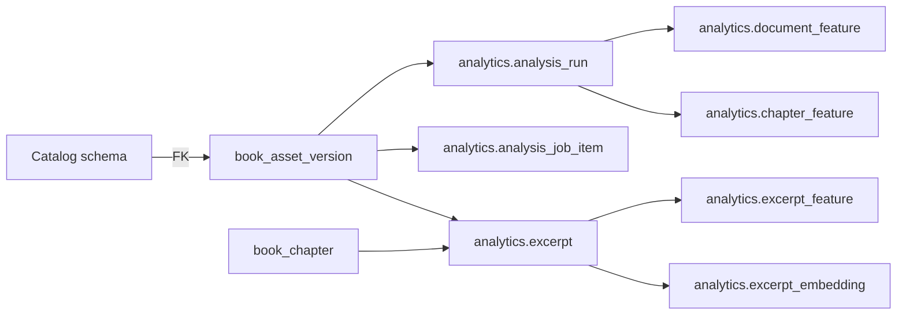

# Relatório operacional da pipeline de analytics

**Base de evidência operacional:** 30 de setembro de 2026 (BRT)
**Owner:** `book-analytics-service` / schema PostgreSQL `analytics`  
**Escopo:** estado implementado e dados persistidos; este documento não declara
prontidão para processamento em massa ou validação científica de modelos.

As decisões de arquitetura para processamento de lotes pesados, recuperação de
leases, persistência em lote e poda de candidatos estão em
[Arquitetura de processamento em lote](batch-processing-architecture.md).

## Situação atual

## Operação pelo Admin Web

O painel administrativo de analytics foi organizado para operar com milhares de
livros sem carregar a biblioteca inteira na tela. A entrada é a tabela compacta
de **jobs**, que permite filtrar por ID/status e ordenar por data, status ou
progresso. A lista usa paginação (`limit`/`offset`) e atualização automática.

Ao abrir um job, a tela mostra apenas os itens daquele job, com filtro por
`PENDING`, `RUNNING`, `COMPLETED` ou `FAILED`, busca por item/asset/livro,
ordenação por início, tentativas ou status e paginação de 100 itens. Cada item
abre seu rastreamento individual, que apresenta a fase atual, tentativa,
horários, duração e status de cada fase persistida, contagens de excerpts,
features e embeddings e as fases ainda pendentes.

### Retomada segura durante atualização

O worker executa cada item em uma tarefa independente e grava o progresso por
lote. A persistência de features de documento usa quatro parâmetros e
`ON CONFLICT DO NOTHING`, portanto uma reinicialização pode repetir o lote sem
duplicar observações já gravadas. Ao reivindicar uma nova tentativa, o worker
limpa o erro da tentativa anterior para que a interface não exiba uma exceção
antiga como se fosse o erro da execução atual. O stale recovery marca fases
abandonadas e reencaminha itens dentro do limite de tentativas; itens que
atingiram o limite ficam explicitamente `FAILED`, em vez de permanecerem
presos como `PENDING`.

Em 18/10/2026 foi corrigido um placeholder extra na inserção de
`analytics.document_feature`. Esse erro lançava
`DataIntegrityViolationException` durante `EXCERPT_EMBEDDINGS` depois de
alguns lotes, sem invalidar os embeddings já persistidos. O teste unitário
verifica agora que a query possui exatamente quatro placeholders correspondentes
aos argumentos fornecidos.

Também foi corrigida a consulta paginada de itens do Admin Web: como ela faz
joins com catálogo, `job_id`, `status`, `created_at` e `id` precisam ser
qualificados com o alias de `analysis_job_item`. Sem isso, PostgreSQL retornava
`column reference "created_at" is ambiguous` e a tela recebia HTTP 500.

### Detalhe operacional por fase

O detalhe do item retorna `logs` dentro de cada fase. Cada evento possui
timestamp, nível, mensagem e, quando aplicável, `progress_completed` e
`progress_total`. O worker grava eventos de início/fim e atualizações de lote;
em embeddings, por exemplo, a tela pode mostrar `365/500` e o último lote
persistido. O Admin Web apresenta cada fase como uma seção expansível com barra
de progresso e histórico de eventos. Fases antigas sem eventos continuam
visíveis com sua duração persistida, mas não podem ser retroativamente
detalhadas.

O número da tentativa é monotônico por item. Durante o claim, o worker usa o
maior `attempt_count` já persistido nas fases, e não apenas o contador atual do
item. A migration V24 também renumera execuções históricas quando um requeue
manual antigo reutilizou números; isso impede que duas execuções sejam
agrupadas na mesma aba do admin e evita burlar `max-attempts`.
Fases `RUNNING` de uma tentativa menor que a atual são fechadas como
`WORKER_RESTART_RECOVERY`, evitando que uma execução antiga continue aparecendo
como ativa depois que o item avançou.

As estatísticas `excerpts`, `features` e `embeddings` são calculadas pelo
`analysis_run_id` através das tabelas de features do run. Excerpts são
reutilizáveis por versão de asset e, por isso, não possuem `analysis_run_id`
direto; a consulta do detalhe não deve assumir essa coluna em
`analytics.excerpt`.

Os endpoints administrativos usados nessa navegação são:

- `GET /api/admin/v1/content-analytics/jobs?limit=200&offset=0`
- `GET /api/admin/v1/content-analytics/jobs/{jobId}`
- `GET /api/admin/v1/content-analytics/jobs/{jobId}/items?limit=100&offset=0&status=...`
- `GET /api/admin/v1/content-analytics/jobs/{jobId}/items/{itemId}`

Eles continuam protegidos pelo escopo `bookrush.analytics`; a paginação não
remove autorização nem expõe dados fora do job solicitado. O detalhe do item é
observacional: ele lê as fases e métricas persistidas pelo worker e não dispara
uma nova execução.

A pipeline barata está operacional no ambiente atual. O serviço Spring Boot é o
único writer do schema `analytics`, o worker persistente está habilitado e o
modo offline está ativo. A execução não baixa modelos no startup.

A inspeção do PostgreSQL naquela data encontrou:

| Medida | Valor |
| --- | ---: |
| Jobs de analytics concluídos | 2 |
| Itens de job concluídos | 3 |
| Itens de job com falha | 0 |
| `analysis_run` concluídos | 2 |
| Versões textuais com excerpts | 2 |
| Excerpts persistidos | 6.153 |
| Features de excerpt persistidas | 30.765 |
| Features de documento persistidas | 0 |
| Features de capítulo persistidas | 0 |

O último job registrado nessa inspeção, que processou duas versões textuais, foi criado em 15/09/2026,
terminou com `COMPLETED`, processou 2/2 itens e não registrou falhas. Os dados
foram produzidos a partir da validação controlada dos livros Gutenberg 84 e
1342. O histórico de incidentes e o procedimento reprodutível estão em
[troubleshooting da pipeline](pipeline-troubleshooting.md).

As migrations V7–V14 evoluíram o modelo após essa fotografia: metadados V2 de
features, runtime opcional linguístico/semântico, campanhas de anotação humana
e elegibilidade estrutural para o feed. Isso não altera os números acima. O
[modelo de dados](data-model.md) separa estruturas implementadas de observações
efetivamente produzidas.

## Fronteira e linhagem



O catálogo continua dono de `book`, `edition`, assets e versões físicas. Cada
entrada de analytics é uma FK para `catalog.book_asset_version`; não há análise
presa apenas a uma obra abstrata. Um excerpt armazena a versão de origem, hash
SHA-256, offsets Unicode em **code points** e intervalo half-open
`[start_codepoint, end_codepoint)`. Quando houver capítulo, ele também é uma FK
real para `catalog.book_chapter`.

Isso impede que uma nova versão de texto altere excerpts, offsets ou observações
históricas de outra versão.

## Fluxo executado

```text
TXT normalizado e versionado
  → job persistente e idempotente
  → analysis_run por asset version
  → geração de excerpts alinhados a sentenças
  → filtros e métricas determinísticas
  → feature/excerpt/ranking com proveniência
```

O job é identificado por `operation_key` e `request_hash`. Repetir a mesma
requisição recupera o job existente; reutilizar a mesma chave com outra entrada
retorna conflito. Itens falhos ou cancelados podem ser retomados sem apagar
histórico; o cancelamento é cooperativo.

A chave de entrada é sempre uma lista explícita de `book_asset_version_id`. O
serviço não descobre livros por conta própria e não inicia importação,
crawling ou processamento em massa no boot.

## Schema `analytics`

As migrations estão no caminho
`services/book-analytics-service/src/main/resources/db/migration` do checkout.
Elas são aditivas; nenhuma migration aplicada deve ser alterada.

| Grupo | Tabelas | Responsabilidade |
| --- | --- | --- |
| Execução | `analysis_job`, `analysis_job_item`, `analysis_run`, `analyzer` | Fila persistente, tentativas, estágio, executor e configuração da execução. |
| Contrato de features | `feature_definition`, `document_feature`, `chapter_feature`, `excerpt_feature` | Definições semânticas e observações com escopo e FK real. |
| Trechos | `excerpt`, `excerpt_rank` | Texto candidato, offsets, hash, gerador e score explicável. |
| Embeddings | `embedding_model`, `document_embedding`, `chapter_embedding`, `excerpt_embedding` | Identidade de modelo, dimensão, hash de entrada e referência ao artefato externo. |
| Artefatos/modelos | `model_artifact`, `corpus_frequency_model`, `style_normalization_model`, `prototype_set`, `topic_model` | Reprodutibilidade de modelos, corpus, protótipos e classificadores. |
| Qualidade humana | `annotation_campaign`, `annotation_campaign_item`, `annotation_assignment`, `annotation`, `annotation_dimension_value`, `annotation_failure_tag`, `annotation_context_diagnostic`, `annotation_event`, `annotation_adjudication`, `annotation_dataset_version`, `annotation_dataset_item` | Campanhas, protocolo, amostra, rótulos, auditoria, adjudicação e snapshot exportável de dataset. |
| Controle técnico | `flyway_schema_history` | Histórico de DDL do owner analytics. |

### Integridade e histórico

- FKs usam `ON DELETE RESTRICT` onde dados históricos dependem de catálogo,
  capítulo, versão textual, analyzer, feature, excerpt ou modelo.
- `analysis_job_item` é único por `(job_id, input_asset_version_id)`.
- Um excerpt é único por versão textual, intervalo e versão do gerador.
- `body_eligible` e `exclusion_reason` registram o filtro estrutural usado
  antes do consumo pelo feed.
- Embeddings são únicos por entidade, modelo e hash da entrada.
- Observações usam tabelas por escopo; não há chave polimórfica
  `entity_type/entity_id` sem integridade.
- Valores de feature aceitam exatamente um entre número, texto ou JSON.
- `value_status` distingue `VALID`, `UNSUPPORTED`, `INVALID_INPUT`,
  `INSUFFICIENT_SAMPLE`, `MODEL_UNAVAILABLE` e `ERROR`; ausência de suporte não
  deve ser gravada como zero.

### Evolução das migrations

| Migration | Conteúdo |
| --- | --- |
| V1 | Fundação: analyzer, run, definição/observações de feature, excerpt e embeddings documento/excerpt. |
| V2 | Jobs persistentes, itens, cancelamento e contadores. |
| V3 | Analyzer e cinco definições determinísticas iniciais. |
| V4 | Registro de modelo de embedding desabilitado localmente. |
| V5 | Hash de requisição para idempotência. |
| V6 | Linhagem V1: artefatos de modelo, status de valor, embedding de capítulo, corpus, estilo, protótipos, tópicos e ranking. |
| V7–V10 | Categorias/versões de features e definições estruturais, linguísticas, lexicais e spaCy V2. |
| V11–V12 | Definições de observações NLI e similaridade com protótipos semânticos. |
| V13 | Campanhas e datasets versionados de anotação humana. |
| V14 | Elegibilidade estrutural persistida de excerpts para o feed. |

## Features efetivamente produzidas na inspeção

A execução validada gerou cinco medições determinísticas por excerpt:

| Código | Semântica operacional atual |
| --- | --- |
| `word_count` | Contagem Unicode-aware de tokens. |
| `sentence_count` | Estimativa de fronteiras de sentença. |
| `question_ratio` | Perguntas divididas por sentenças estimadas. |
| `dialogue_ratio` | Caracteres em delimitadores de diálogo divididos por code points. |
| `estimated_read_time` | Palavras divididas por 200 palavras/minuto no baseline atualmente implementado. |

O checkout atual contém definições adicionais estruturais, lexicais,
linguísticas, semânticas e narrativas e o worker tenta produzi-las quando os
adaptadores locais retornam `VALID`. Elas não devem ser consideradas calculadas
em um ambiente só porque têm definição, tabela ou migration. A ausência, na
inspeção, de
`document_feature` e `chapter_feature` confirma que a execução validada focou
features baratas de excerpt.

`excerpt_rank` suporta versão, hash de configuração, componentes, pesos e
motivo de exclusão. Quando usado, é uma ordenação heurística, explicitamente
não validada; não mede qualidade, engajamento, interesse ou probabilidade
comportamental.

## Modelos e modo offline

A configuração operacional atual mantém:

```text
ANALYTICS_WORKER_ENABLED=true
ANALYTICS_OFFLINE=true
ANALYTICS_MODEL_CACHE_DIR=/var/lib/bookrush/models
```

O código atual contém adaptadores para fastText, spaCy EN/PT, BGE-M3 e NLI
multilíngue. Eles são condicionais ao runtime e aos artefatos locais válidos;
o serviço não baixa modelos no startup. A fotografia de 30/09 não comprovou
embeddings BGE, scores de protótipos ou NLI persistidos. Para qualquer ambiente
posterior, confirmar `analysis_run`, `value_status` e os registros de embedding
antes de declarar essas saídas disponíveis. Artefato ausente ou inválido deve
produzir status apropriado, nunca um score inventado.

Veja [preparação de modelos](../analytics-models.md),
[contrato Content Analytics V1](../analytics-v1.md),
[ADR-004](../adr/ADR-004-analytics-ownership.md),
[ADR-005](../adr/ADR-005-analytics-embedding-storage.md) e
[ADR-010](../adr/ADR-010-analytics-owner-and-runtime.md).

## APIs

A base pública é `/analytics/api` através do gateway. As rotas administrativas
criam e controlam jobs; as internas leem dados ligados ao catálogo.

| Método | Rota | Finalidade |
| --- | --- | --- |
| POST | `/api/admin/v1/content-analytics/jobs` | Cria ou recupera job idempotente. |
| GET | `/api/admin/v1/content-analytics/jobs?limit=100&status=RUNNING` | Lista jobs recentes com estágio e contadores para a operação. |
| GET | `/api/admin/v1/content-analytics/jobs/{jobId}` | Estado e contadores persistidos. |
| POST | `/api/admin/v1/content-analytics/jobs/{jobId}/cancel` | Solicita cancelamento cooperativo. |
| GET | `/api/admin/v1/content-analytics/jobs/{jobId}/items` | Itens, tentativas e erros sanitizados. |
| GET | `/api/internal/v1/content-analytics/books/{bookId}` | Resumo por versões textuais. |
| GET | `/api/internal/v1/content-analytics/books/{bookId}/excerpts` | Excerpts paginados por livro. |
| GET | `/api/internal/v1/content-analytics/asset-versions/{assetVersionId}` | Observações/excerpts de uma versão exata. |
| GET | `/api/internal/v1/content-analytics/excerpts/{excerptId}` | Excerpt, hash e linhagem. |

O namespace administrativo `/api/admin/v1/annotation` implementa campanhas de
anotação: criação/amostragem, claim, progresso por anotador, item cego,
first-screen lock, contexto anterior/seguinte após o lock, submissão, métricas,
adjudicação e exportação de dataset. O item cego não expõe scores; o contexto e
os scores só são liberados após o lock primário. Ele é reservado a operadores,
anotadores e revisores; detalhes do modelo estão em [data-model.md](data-model.md).

A amostragem de uma campanha usa o `sampling_config` e o
`sampling_config_hash` persistidos na criação. Para o piloto EQL, a política
`languages: ["en", "pt"]` com `targetPerLanguage: 50` materializa até 50
excerpts determinísticos por idioma, ordenados por `md5(excerpt_id || seed)`.
Cada item registra o estrato (`en:position`/`pt:position`) e a razão com o
idioma e a seed; a restrição única `(campaign_id, excerpt_id)` impede duplicatas.
Executar a amostragem novamente é seguro e retorna o mesmo hash da campanha.

`Idempotency-Key`, quando presente, deve ser igual a `operationKey`. A API
rejeita a mesma chave com corpo diferente. O contrato OpenAPI do serviço é a
fonte de detalhes de payload, autenticação e respostas.

## Operação e observabilidade

O serviço expõe health, info e métricas Spring Boot. Métricas operacionais
incluem criação/replay/conflito de jobs, itens processados, excerpts listados e
etapas de execução. Logs podem usar ID de job, versão de asset, analyzer e
estágio, mas não devem registrar tokens, segredos, URLs assinadas ou o texto
integral do livro.

Para uma nova execução controlada:

1. execute ingestão e confirme a versão TXT normalizada no catálogo;
2. crie um job com apenas os UUIDs das versões textuais desejadas;
3. acompanhe job e itens até estado terminal;
4. consulte excerpts por versão e valide hash/offset antes de ampliar lote;
5. execute `bash scripts/test-analytics-e2e.sh` em ambiente descartável antes
   de alterar configuração, modelo ou gerador.

## Limitações e próximos gates

A pipeline atual é adequada para validar persistência, linhagem, idempotência,
geração de excerpts e métricas baratas. Ela **não está aprovada para bulk**.

Antes de um lote maior, é necessário:

1. concluir `bookrush-av114`: congelar revisões, licenças e SHA-256 dos modelos;
2. preparar o cache por mecanismo explícito e validar execução offline;
3. implementar/validar os analyzers PT/EN, embeddings e NLI com tolerâncias;
4. construir corpus-frequency e normalização de estilo a partir de snapshot
   elegível e versionado;
5. executar os gates 1–8 de `VALIDATION_PLAN_V1.md` e registrar decisão GO;
6. medir throughput, storage e memória no piloto antes de iniciar qualquer
   corpus completo.

### Reinício limpo do piloto

Quando um job acumular falhas de uma versão antiga do worker, não se deve
apagar suas linhas nem reutilizar sua `operation_key`. O procedimento é:

1. preservar o job antigo como evidência e marcá-lo como cancelado/reiniciado;
2. criar uma nova `operation_key` e copiar somente os
   `input_asset_version_id` para itens `PENDING`;
3. acompanhar a nova execução pela listagem administrativa, que consulta
   `analysis_job` (não apenas `analysis_run`);
4. comparar falhas e tempos com o job antigo somente depois de o lote novo
   avançar.

Em 18/10/2026 o lote sujo de 498 itens foi preservado e substituído por uma
execução limpa. O admin passou a atualizar a lista de jobs a cada três
segundos, exibindo status, estágio e contadores persistidos. A consulta exige o
mesmo bearer administrativo e audience/scope `bookrush.analytics` das demais
rotas de analytics.

O princípio permanece: medições, scores de modelo e scores de produto têm
semânticas diferentes. Analytics V1 produz observações rastreáveis; não afirma
ter resolvido compreensão literária ou recomendação de usuários.
