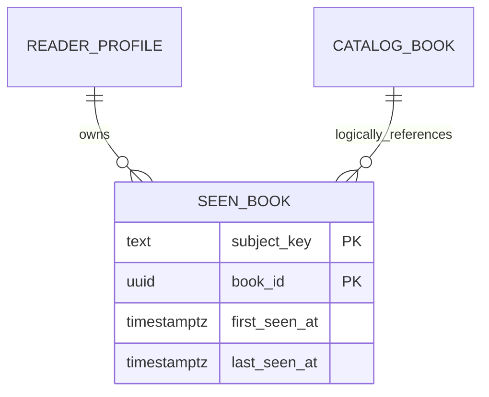

# Reader state database

`reader-state-service` owns the `reader_state` schema and all state is keyed by
the authenticated opaque subject, never by an email supplied by the client.
Library, progress, recent books, bookmarks and sessions are persisted in
PostgreSQL. The `reading_day` table is a rebuildable daily projection used by
`GET /api/v1/reader/streak`.

Ending a session is idempotently restricted to the current subject and an open
session. Its non-negative `activeSeconds` value contributes whole minutes to
the current UTC database day. A missing or malformed duration is treated as
zero. The service does not expose another user's state and does not infer a
profile or recommendation from this projection.

A projeção `daily-reading-v2` da planta usa as tabelas `daily_plant`,
`plant_reading_day` e `plant_reading_event` da migration V6. Ela começa no
estágio zero sem alterar o histórico anterior. Os intervalos autenticados são
contados em segundos e divididos na virada de dia em America/Sao_Paulo; o
identificador do evento evita a duplicação em retentativas.

As alterações de atribuição da sessão seguem a sequência Flyway V7 (livro,
recommendation item e impression) e V8 (correlação complementar). A separação
mantém V6 reservado à planta diária e evita versões duplicadas no boot.

## Marca persistente de conteúdo visto

V9 acrescenta a entidade privada abaixo. O subject é derivado da autenticação
e book_id é referência lógica ao catálogo, preservando histórico após remoção.
Categorias continuam no domínio catalog.subject/book_subject (V14).

Visto = publicação carregada no leitor. Há uma linha por subject/livro, sem
limite de histórico ou FK entre serviços. A consulta utiliza PK e um lote
limitado de IDs; não revela o histórico de outro perfil. A transação de abertura
escreve recent e seen_book; nenhuma tabela de planta ou progresso é modificada.
