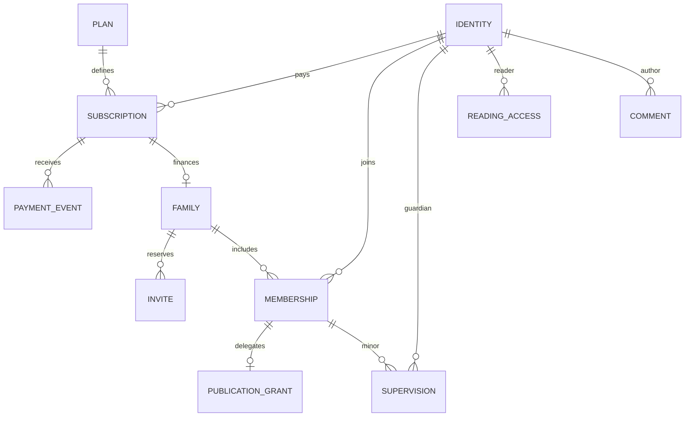

# Premium, família e supervisão parental

[Política etária e de supervisão v1](age-supervision-v1/README.md) detalha as regras finais do protótipo acadêmico e a revisão necessária para eventual implantação comercial.

Plano de implementação. Baseline da main remota inspecionada em checkout
isolado: `bd257d74a531f26961c340ef40e50fb7e783ec49`.
Decisões propostas nos [ADR 0035](../adr/ADR-0035-premium-family-ownership.md)
e [ADR 0036](../adr/ADR-0036-product-access-and-publisher.md).

## Diagnóstico da baseline

| Área | Evidência e impacto |
|---|---|
| Keycloak | `infrastructure/keycloak/bookrush-realm.json` permite cadastro e `bookrush-platform-realm.json` o desabilita. Os arquivos e `render-config.py`/`reconcile.sh` não declaram contrato de nascimento. O reconciliador executa config-cli no Compose e passos de Admin API. Incluir User Profile via configuração suportada pela versão usada ou PUT idempotente do perfil, preservando atributos existentes. |
| Segurança | `BookrushSecurityAutoConfiguration` instala chain só na ausência de chain própria. Valida issuer, audience e tempo e converte scope, grupos e roles. `TechnicalIdentity` é uma tupla de issuer e subject. O principal serializado pelo starter e o subject cru de chains próprias exigem adaptação explícita. |
| Web e mobile | `frontend/src/auth.ts` recupera sessão da sessionStorage, processa retorno OIDC e refresh silencioso. `AuthLanding.tsx` encaminha cadastro ao IdP. `mobile/App.tsx` usa Expo AuthSession, Code + PKCE, cadastro com deep link e token em memória. Realizar bootstrap após login/restauração/refresh antes de montar recursos de produto. |
| Estado e comportamento | `ReaderStateController` opera progress, recent, seen_book, session, library, bookmarks e streak (migrations V1–V11). `BehaviorController` recebe eventos e expõe agregados, incluindo pessoais, e há endpoints internos de recomendação e métricas. Eventos e sinais de cliente servem à análise, com outbox próprio. Separar registro confiável de acesso do fluxo analítico. |
| Social e perfil | `SocialController` e `BookRatingsController` atendem comentários, follows, likes, shares, reports, moderação e avaliações. `social.comments` é o dado autoral, sujeito a moderação e exclusão. `ProfileController` e `ProfileSearchController` expõem perfil, privacidade e busca. Cadastro recém-criado pode anteceder a criação de perfil, então convite exige lookup interno no IdP. Proteger busca e impedir exposição indevida de menores. |
| Leitura e catálogo | `ReaderBffController` compõe feed, biblioteca, progresso, livros, capítulos, publication.json e recursos. `ContentController` expõe caminhos equivalentes e URLs. `AssetSecurity` libera GETs genéricos de livros e download legado; exceções cobrem thumbnail e alguns reader-assets. Conferir `ReaderContentController`, `DistributionController` e todos os caminhos equivalentes. |
| Gateway e storage | `infrastructure/traefik/dynamic.yaml` roteia BFF, content, publisher, social, perfil e behavior diretamente e mantém catch-all /api para catálogo. Revisar prioridades, caminhos internos, nginx, portas Compose e Ingress de K8s. O host público S3 atende URLs assinadas do catálogo e PUT de staging. Assinatura de URL carrega autorização própria até expirar. |
| Entrega | Compose configura publisher com issuer de plataforma e audience administrativa de ingestão, além de clientes técnicos de métricas. O Jenkins integrado lista imagens explicitamente e tem cópia em `infrastructure/jenkins/bookrush.Jenkinsfile`. `infrastructure/kubernetes/base` cobre um subconjunto (catálogo, ingestão, analytics, frontend e dependências). Declarar cobertura e paridade por ambiente. Publicar metadados de componentes, APIs, dependências e TechDocs no Backstage. |
| Regressão | OpenAPI em `services/*/api`, Flyway em `src/main/resources/db/migration`, scripts `test-keycloak-*.sh`, `test-reader-bff-e2e.sh`, `test-profile-search-e2e.sh`, `test-storage.sh`, `test-book-ratings-e2e.sh` e `pfv1-gateway-e2e.sh` oferecem pontos de extensão. Inspecionar cobertura de métodos dos controllers onde YAML cobre apenas parte da API. |

## Domínio e invariantes



Relações entre owners são referências opacas, sem joins, FKs ou acesso a
schemas externos. Subscription guarda versão de oferta, referência do provedor,
estado, períodos e effectiveUntil. Família tem um titular adulto, único grupo
comercial ativo por conta no MVP, cinco assentos adicionais e referência ao
entitlement do titular. Membership mantém status e datas. Convite guarda
identidade do destinatário, estado, prazo e autor. Unidade de ocupação:
membros ativos ou suspensos + convites pendentes ainda válidos. Lock na família
e constraint de unicidade de vínculo ativo serializam reservas, aceite e remoção.
Aceite do próprio destinatário converte a reserva em membership em uma transação.
Conflito em outro grupo, falta de entitlement ou expiração aborta a operação.
Operações repetidas com a mesma chave e payload retornam o resultado original.

Supervisão guarda par responsável/menor, estado, escopos separados
`PRODUCT_ACCESS`, `READING_HISTORY`, `COMMENTS`, vigência e referência restrita
à verificação. O responsável pode ser pessoa distinta do titular, com identidade
adulta validada. Aprovação por fluxo operacional dedicado após verificação
definida por Produto/Privacidade. O titular comercial pode controlar vagas e
publicação, e só supervisiona via concessão própria. Registrar decisão e versão,
com evidência sensível em repositório restrito aprovado. Começar com publicação
de menores desabilitada até decisão específica.

## Matriz de autorização

Condições cumulativas por ação. Suspensão global da conta precede idade e planos.
Livre acesso de adulto vale para conta regular com idade conhecida. Suspensão
comercial do membro revoga seus benefícios e, se menor, acesso ao produto.

| Ator e estado | Sessão mínima, convites próprios | Produto | Publicação | Família e supervisão |
|---|---|---|---|---|
| Data ausente, inválida ou em revisão | Sim, com atualização de cadastro quando elegível | Bloqueado | Bloqueado | Bloqueado |
| Menor sem vínculo ativo ou sem autorização de acesso | Sim | Bloqueado | Bloqueado | Bloqueado |
| Menor com vínculo ativo, família vigente e autorização válida | Sim | Sim | Bloqueado na primeira versão | Sem gestão |
| Adulto gratuito, inclusive membro removido | Sim | Sim | Leitura autoral própria e retirada, se houver legado | Sem gestão comercial |
| Titular Premium vigente | Sim | Sim | Criar, editar, subir e submeter obras próprias | Criar família, convidar, remover, delegar |
| Membro adulto ativo com delegação e família vigente | Sim | Sim | Escrita autoral própria | Sem gestão comercial |
| Adulto responsável verificado e autorizado | Sim | Sim | Pelo direito comercial próprio | Só escopos do menor elegível explicitamente vinculado |
| Suspensão global | Recuperação e logout conforme IdP | Bloqueado | Bloqueado | Bloqueado |
| Operador editorial / serviço técnico | Rotas próprias | Ações técnicas explícitas | Revisão editorial / callback delimitado | Operação de supervisão somente com função dedicada |

Adulto alvo nunca entra em consulta supervisionada, inclusive após aniversário.
Visibilidade social normal segue suas regras próprias. Revogação da escrita
preserva leitura autoral própria para adultos habilitados ao produto e retirada
de obras próprias. A retirada nunca depende de renovar a assinatura.

## Contratos HTTP propostos

Erros estruturados em Problem Details com `code` estável e correlation ID.
401 para token ausente ou inválido; 403 para scope ou política insuficiente;
404 para recurso externo inexistente ou sem ownership; 409 para conflito de
estado/ocupação; 422 para payload de domínio inválido; 503 para fato obrigatório
indisponível. Coleções por cursor opaco com limite. Escritas repetíveis levam
`Idempotency-Key`, escopada pelo ator/operação, e alterações concorrentes usam
versão ou If-Match. CORS com origens explícitas de produto ou administração,
conforme rota. S2S sem origem de navegador e sem exposição no ingress.

| Método e caminho | Dono e contrato |
|---|---|
| GET /api/v1/session | Reader BFF, produto aud bookrush-reader-bff, scope de sessão. Retorna username próprio, accessState, reasonCode, capabilities e validUntil, sem DOB. Disponível na sessão restrita. |
| GET /api/v1/family/invitations/me; POST /api/v1/family/invitations/{id}/accept ou /decline | Família, aud bookrush-family, scope de convites próprios. 200 lista ou vínculo; 204 recusa. Visão mínima; decisão lê o titular e o prazo atuais. |
| POST /api/v1/family; GET /api/v1/family/me | Família, mesmo aud, scope de família. Criação 201 e listagem 200 com estado e ocupação conforme papel. |
| POST /api/v1/family/{id}/invitations; DELETE /api/v1/family/{id}/invitations/{inviteId} | Titular vigente, mesmo aud e scope de gestão. 201 reserva, 204 cancela. Lookup exato e limitado, sem busca ampla. Usar identificador de convite compartilhado pelo destinatário se exposição de username for vedada. |
| DELETE /api/v1/family/{id}/members/{memberId}; PUT /api/v1/family/{id}/members/{memberId}/publication | Titular vigente, 204. Corpo de publicação contém enabled e versão. Sem efeitos sobre concessões legais, exceto perda de elegibilidade com fim do vínculo. |
| GET /api/v1/subscription/me; POST /api/v1/subscription/checkout; POST /api/v1/subscription/cancel | Subscription, aud bookrush-subscription, scope billing, adulto; 200 snapshot, 201 sessão do provedor e 202 cancelamento. Cliente envia planId, servidor resolve preço e destino. |
| POST /api/v1/billing/webhooks/{provider} | Subscription. Autenticação de webhook do provedor, persistência e dedupe por ID antes de 2xx. Fonte de verdade de cobrança validada no servidor. |
| PUT /api/v1/admin/supervision/{id}; DELETE /api/v1/admin/supervision/{id} | Família, plataforma aud bookrush-family-admin e scope supervision.manage. 200/204, motivo e trilha auditável; verificação fora do fluxo de aceite familiar. |
| POST /api/internal/v1/product-access/decisions | Família, aud bookrush-family, cliente S2S allowlisted e scope product-access.evaluate. Recebe actor técnico e identidade humana derivada de JWT já validado, action, target/resource e correlationId. Retorna allow, reasonCode, policyVersion, factVersions e validUntil. Autoridade do cliente limitada a ações do próprio serviço. Família avalia vínculo, idade e supervisão e consulta entitlement somente onde necessário. |
| POST /api/internal/v1/subscription/entitlements/evaluate | Subscription, aud bookrush-subscription e scope entitlements.evaluate, cliente família. Recebe owner e entitlement solicitado, devolve enabled, effectiveUntil e version. |
| GET /api/v1/reader/supervision/{memberId}/history; GET /api/v1/reader/supervision/{memberId}/comments | BFF, aud bookrush-reader-bff e scope supervision.read. Consultas internas paginadas em reader-state e social com credencial S2S própria e contexto autenticado do ator e alvo. Donos reavaliam a concessão atual antes de responder. História: bookId e instantes de acesso efetivo. Comentários: id, bookId, conteúdo permitido e data. Sem exportação ou consultas coletivas no MVP. |

Ações compartilhadas: SESSION_VIEW, INVITE_SELF, PRODUCT_USE, PUBLISH_READ,
PUBLISH_WRITE, PUBLISH_WITHDRAW, FAMILY_MANAGE, SUPERVISE_HISTORY e
SUPERVISE_COMMENTS. S2S usa identidade de workload e escopo próprio, sem usar
headers públicos como identidade. Nos donos, validar antes de ler/escrever ou
assinar URL. Projetar timeouts curtos, circuit breaker com 503 e sem permit
em falha. No MVP consultar fato atual para writes, emissão de URL e supervisão,
sem cache de allow entre requests. Segurança de leitura sensível tem mesma
política. A decisão resolve idade por um adaptador Keycloak de menor privilégio
ou projeção local auditada com reconciliação, sujeita a freshness contratual.
Evitar ciclo de chamada família → starter → família nas rotas internas.

## Eventos e lifecycle

Envelope v1: eventId, eventType, schemaVersion, producer, occurredAt,
aggregateId, aggregateVersion, correlationId, payload mínimo. Outbox transacional
PostgreSQL e polling com inbox único por consumidor, retry com backoff, dead
letter e reconciliação via snapshot em gap de versão. Tratar eventos como
sinal de invalidação ou materialização, sem substituir checagem atual.
Subscription emite `EntitlementChanged` (ownerRef, status, effectiveUntil);
família emite `InvitationChanged`, `MembershipChanged`, `PublicationGrantChanged`
e `SupervisionChanged` (IDs opacos, status e vigência para consumidores
autorizados). Política etária processa `AgeEligibilityChanged` com classificação
e vigência, sem DOB. Content emite `ReadingAccessed` após servir conteúdo
protegido com sucesso, dedupe por eventId e agregação no reader-state. A entrega
do recurso é proxy mensurável de acesso, sem inferir leitura completa. Definir
para downloads o evento comprovável e documentar lacunas históricas.

- Cancelamento normal mantém direito até effectiveUntil; estorno/suspensão
  segue decisão comercial e pode revogar imediatamente. Família fica suspensa
  sem eliminar vínculos; nega aceite e delegação; cancelar convites
  pendentes. A supervisão gratuita segue a concessão legal vigente. Reativar só após verificar estado e vigência atuais.
- Remoção ou suspensão comercial revoga direitos derivados. A suspensão ou revogação legal encerra os escopos de supervisão afetados.
  Preservar trilhas e dados conforme retenção aprovada. Queda do titular
  suspende a família. Expiração conta pela hora do servidor, com cleanup assíncrono.
- Aos 18, derivar estado por data civil e relógio injetável a cada decisão.
  Encerrar supervisão no instante de corte mesmo com job atrasado; manter
  vínculo comercial e aplicar política adulta. O protótipo usa America/Sao_Paulo
  e 01/03 para 29/02 quando necessário. Reavaliar direitos após correção.
- Reconciliar webhooks fora de ordem com versão do provedor ou consulta de
  estado autoritativo. Período pago termina pelo relógio mesmo sem webhook.
- Mudanças simultâneas a operações irreversíveis exigem nova decisão na
  transição final (aprovação, promoção de upload) e auditoria da versão usada.
  Definir a ordenação no ponto de decisão e compensar trabalho em trânsito.

## Publisher: migração método a método

Hoje a chain própria autentica com um issuer/audience, extrai grupos e scopes
e libera o prefixo interno para validação de segredo pelo callback. A regra
de membership é chamada apenas em alguns métodos e cria linha local
automaticamente. Revisão verifica grupos `operators`/`platform-admins`.
Os demais controles atuais e seus destinos são:

| Método sob /api/v1/publisher | Controle atual | Proposta |
|---|---|---|
| GET /membership | Cria/consulta membership e rejeita suspenso | Produto, leitura própria sem side effect, retornar direitos efetivos |
| POST /submissions | Membership local | Produto, scope publisher.write, entitlement e suspensão |
| GET /submissions; GET /submissions/{id}; GET /submissions/{id}/reviews | Filtro por subject | Produto, scope publisher.read e ownership; projetar histórico editorial sem identificador interno desnecessário |
| GET /submissions/{id}/metrics | Ownership; cliente técnico para agregados | Produto, publisher.read e ownership; preservar supressão por amostra. Admin-web usa fachada administrativa separada |
| PUT /submissions/{id}/metadata; POST /submissions/{id}/rights | Membership, SQL usa ID informado sem filtrar owner | Produto, publisher.write e SQL condicionado a owner e estado editável, na mesma transação |
| POST /submissions/{id}/upload; POST /submissions/{id}/upload/{uploadId}/finalize | Ownership, staging opt-in, URL de PUT e HEAD | Produto, publisher.write em ambas, chave opaca, limite e hash validados, transições idempotentes |
| POST /submissions/{id}/submit | Owner e estado DRAFT/UPLOADED | Produto, publisher.write e eligibility atual; persistir estado + outbox de ingestão antes de disparar |
| POST /submissions/{id}/withdraw | Obra publicada do owner | Produto, publisher.withdraw, owner, sem exigência Premium; exclusão mútua com aprovação |
| GET /review; POST /submissions/{id}/review | Grupos de operador | Mover a GET /api/v1/admin/publisher/review e POST /api/v1/admin/publisher/submissions/{id}/review, com audience bookrush-publisher-admin, scope publisher.review e grupo editorial de plataforma. Aprovar com direito autoral vigente, estado elegível e material validado, em transação |
| POST /api/internal/v1/publisher/submissions/{id}/catalog-link | Segredo e conflito de link no controller | Ingress privado, workload de ingestão, audience bookrush-publisher-internal e scope publisher.catalog-link. Idempotência atômica e validação de estado/job |
| GET /actuator/health e /actuator/prometheus | Liberados na chain | Health mínimo ao balanceador; métricas na rede operacional |

Fixar audience `bookrush-publisher` e issuer de produto nos caminhos
autorais. Validar assinatura, issuer, tempo e audience nas três chains,
roteadas por método e caminho e com deny por padrão. Migrar fallback de
segredo junto com `PublisherIngestionClient`, `PublisherSubmissionLinkClient`
e `PublisherAssetIngestionController`; durante transição, restringir o
fallback ao método e rede definidos e medir uso antes da retirada.
Atualizar `admin-web/src/features/publisher/publisherMetrics.ts`, contratos e
rotas Traefik. Ajustar `BehaviorEventPublisher` para emitir fatos de autoria
com workload autenticado e ator explícito, preservando contratos de métricas
sem encaminhar bearer administrativo a endpoint de produto. Revisar os mappers
de web/mobile e a configuração de segurança habilitada nos perfis publicados.
A chain de segurança desabilitada serve apenas a execução local isolada.

Adicionar issuer/subject a membership, submission, uploads, obras, atestados
e revisões onde identificam atores, com índices e rollout dual-read/write
restrito ao fluxo legado. Legado de subject cru recebe issuer de plataforma
após validar proveniência; casos ambíguos ficam em quarentena. Transferência
de autoria exige vínculo auditado de duas identidades verificadas, nunca
correlação automática por string, e-mail ou username. Preservar revisão e
trilha de autoria original. Evitar exposição dos dois modelos ao mesmo
endpoint depois do corte. Cancelamento preserva obra já publicada, congelando
novas publicações pendentes até recuperação ou retirada. Confirmar regra
editorial antes da ativação.

## Fechamento de caminhos alternativos

Produto protegido exige bearer inclusive para GET anônimo equivalente.
Inventariar método, matcher, rota de entrada, owner, credencial downstream
e efeito. Expectativa: apenas bootstrap estático, OIDC e health mínimo
públicos. Qualquer catálogo público futuro terá DTO e rota aprovados
explicitamente, sem habilitar leitura autenticada restrita via GET anônimo.
Conferir Traefik e nginx, matchers genéricos /api, aliases internos, Ingress,
portas/NodePorts e chamadas diretas no serviço. Telemetria e recomendação
validam seus workloads e não aceitam impersonação por headers externos.
Credencial S2S sabe distinguir leitura de sistema de chamada em nome de
usuário. Serviços que recebem apenas S2S exigem contexto de ator confiável
e rechecagem local em chamadas delegadas, especialmente conteúdo.

Para GET sensível de capítulos, manifestos e recursos, preferir delivery
autenticado com cache privado e revalidação. Proteger range/HEAD, downloads
legados e redirects. Em caso de revogação que exija efeito imediato, servir
via proxy autenticado, eliminar emissão legada e aguardar a expiração das
URLs anteriores antes de ativar a coorte. PUT temporário só para objeto
privado e isolado, com TTL curto e limpeza. O direito é reavaliado no finalize,
submit e revisão; upload expirado ou revogado nunca promove conteúdo. Testar
replay, divergência de tamanho/hash, namespaces e bloqueio de listagem de bucket.
O sistema controla futuras entregas e não recupera arquivos já baixados.

## Migração, validação e rollout

1. Publicar contratos, fixtures e mapa de rotas. Expandir schemas e instalar
   observação de decisões sem habilitar novos fluxos. Reconcile em Keycloak
   25.0 descartável duas vezes. Configurar nascimento como data civil válida,
   obrigatória no cadastro humano de produto, imutável pelo usuário após
   confirmação, inacessível em tokens e APIs públicas. Validar registro e
   Admin API; correção passa por fluxo auditado. Revisar reset, primeiro login,
   broker, Account Console e cadastros administrativos.
2. Classificar legados em lotes auditáveis e disponibilizar ação de preenchimento
   no IdP. Manter o mesmo sub, sessões e dados. Antes do corte medir cobertura
   e comunicar a janela. Na coorte efetivamente ativada, idade desconhecida
   implica tela restrita. Clientes antigos recebem 403 de API e podem exigir
   atualização para abrir convites. Nenhum direito adicional vem de token antigo.
3. Preparar assinatura/família e proteção ponta a ponta. Validar migração em
   PostgreSQL da versão Compose, do zero e upgrade, restrições, concorrência,
   timestamps, idempotência e isolamento de credenciais. Exercer webhooks
   duplicados, atrasados e inválidos, lotação concorrente e expiração.
4. Testar JWT fresco e reaproveitado, exp/nbf, JWKS, realm/aud/scope errados,
   logout/refresh, origem CORS permitida e negada, e chamadas diretas. Validar
   matriz com menor restrito e autorizado, adulto gratuito, titular, membro,
   responsável, operador e workload. Em token ainda válido, revogar grant,
   suspender, remover e cancelar, verificando a próxima decisão. Validar
   aniversário com relógio fixo online, consultas cruzadas, comments excluídos,
   indisponibilidade de donos, estados 401/403/404/409/503 e rollback.
5. Validar OpenAPI, build web/mobile e Java, migrations, Compose config,
   imagens e digests, testes Keycloak/storage e as duas cópias do Jenkinsfile.
   Executar E2E descartável com origens, PKCE e gateway reais do ambiente.
   Validar Ingress/Kustomize por ambiente e cobrir Backstage com exportação
   OpenAPI, entidades e TechDocs. Em implantação futura autorizada, registrar
   SHA, job, parâmetro, digest, health, preflight e smoke público autenticado.
6. Ativar coorte somente com inventário completo e testes negativos aprovados.
   Monitorar 403/503 por ação/rota, latência p95/p99 de decisão, divergência
   de classificação, lag de outbox, vagas e replays, falhas de webhook e
   revogações. Auditoria separada de concessões, decisões supervisionadas e
   mudanças editoriais, com ator/alvo opacos, escopo, política e instante.
   Logs operacionais e labels ficam sem identificadores pessoais, DOB,
   comentários, conteúdo, tokens e URLs assinadas. Definir SLOs e limiares
   antes do canário. Em rollback, congelar escrita comercial e novos aceites,
   manter gate para coortes já protegidas e voltar à versão compatível com
   política restritiva. Preservar migrations e dados; reconciliar outbox e
   assinaturas antes de reativar.

## Revisão para eventual implantação comercial

Produto e Privacidade/Jurídico devem aprovar mercados atendidos, tratamento
da data autodeclarada e casos que exigem prova, elegibilidade e verificação
de responsáveis, divergência entre responsáveis, retirada de autorização,
visibilidade de comentários e livros, período histórico consultável, retenção,
direitos de acesso/exclusão, exclusão de conta e passagem à maioridade. Definir
quem pode arbitrar correções, como tratar titularidade e idade divergentes e
qual fuso civil/caso bissexto vale. Registrar política e evidência operacional
antes do aceite de menores. Produto/Financeiro devem definir provedor, plano,
preço, carência, reativação, estorno e revisão de obras em voo. O desenho
propõe fail-closed e escopos mínimos durante a implementação; os critérios
de verificação permanecem decisões do lançamento.

## Sequência de PRs e grafo Beads

Cada linha tem o ID implementável e seus bloqueadores diretos. O Beads local
é a fonte de estado, escopo e aceite de cada tarefa. As ondas agrupam PRs
independentes quando o grafo permite.

| Onda | Bead | Objetivo | Depende de |
|---|---|---|---|
| 1 | `bookrush-gdch` | Contratos de autorização de produto v1 | — |
| 2 | `bookrush-fyw9` | Validar política etária e supervisão | `bookrush-gdch` |
| 3 | `bookrush-0yle` | Configurar nascimento e classificação no Keycloak | `bookrush-gdch`, `bookrush-fyw9` |
| 2 | `bookrush-8nr0` | Persistir assinatura e entitlement | `bookrush-gdch` |
| 3 | `bookrush-etkw` | Integrar cobrança e reconciliação | `bookrush-8nr0` |
| 3 | `bookrush-wdn2` | Criar família e reservar convites | `bookrush-8nr0`, `bookrush-gdch` |
| 4 | `bookrush-5ine` | Aceitar convites e delegar publicação | `bookrush-wdn2`, `bookrush-0yle` |
| 5 | `bookrush-ybxp` | Persistir supervisão e autorização do menor | `bookrush-5ine`, `bookrush-fyw9` |
| 6 | `bookrush-v33x` | Integrar decisão de produto ao starter | `bookrush-ybxp`, `bookrush-8nr0` |
| 7 | `bookrush-vrro` | Proteger conteúdo e distribuição | `bookrush-v33x` |
| 7 | `bookrush-69q8` | Aplicar gate a estado, social, perfil e telemetria | `bookrush-v33x` |
| 8 | `bookrush-phx3` | Expor histórico supervisionado de leitura | `bookrush-ybxp`, `bookrush-69q8`, `bookrush-vrro` |
| 8 | `bookrush-zut0` | Expor comentários supervisionados | `bookrush-ybxp`, `bookrush-69q8` |
| 7 | `bookrush-4b1u` | Migrar autoria e owner checks do publisher | `bookrush-v33x` |
| 8 | `bookrush-rrnt` | Separar produto, editorial e callback no publisher | `bookrush-4b1u` |
| 9 | `bookrush-ccfg` | Controlar uploads e concessões pendentes do publisher | `bookrush-rrnt`, `bookrush-vrro` |
| 7 | `bookrush-iepl` | Bootstrap de sessão web e mobile | `bookrush-v33x`, `bookrush-5ine` |
| 7 | `bookrush-7164` | Empacotar serviços e contratos na entrega | `bookrush-v33x`, `bookrush-8nr0`, `bookrush-wdn2` |
| 9 | `bookrush-htnx` | Reuso do E2E publisher/admin cross-realm | Dependências existentes + `bookrush-ccfg` |
| 10 | `bookrush-kklh` | Validar ativação e rollback de Premium e Família | `bookrush-etkw`, `bookrush-ybxp`, `bookrush-vrro`, `bookrush-phx3`, `bookrush-zut0`, `bookrush-ccfg`, `bookrush-iepl`, `bookrush-7164`, `bookrush-htnx` |

Primeiro PR técnico: `bookrush-gdch`. Entregar o mapa método/rota/action, o
contrato de decisão v1 e fixtures de 401/403/503 para consumo pelos serviços.
Validar schemas e cobertura do inventário antes de plugar a primeira chain.

## Validação comercial isolada

Execute `bash scripts/test-premium-family-e2e.sh` com Docker e Python 3.
A suíte compila os dois serviços, provisiona PostgreSQL e Keycloak
descartáveis, aplica duas vezes os fragmentos declarativos e usa os arquivos
de rotas do Traefik local. Os usuários e os clientes de teste existem
apenas na rede descartável. O fluxo de senha é exclusivo da fixture e as
credenciais e os tokens de teste não aparecem na saída.

A cobertura inclui checkout MOCK, replay, cinco reservas, isolamento,
estorno com o JWT original, indisponibilidade da dependência S2S, reabertura
das migrations e veto das rotas MOCK sob perfil de produção. A suíte limpa
os containers, volumes anônimos, imagens locais de teste e rede que cria.

Para validar os contratos com `openapi-spec-validator` 0.7.2, execute:

```bash
openapi-spec-validator docs/productization/product-access-v1/openapi.json \
  services/{subscription,family,catalog}-service/api/openapi.yaml
```

A suíte cobre a superfície comercial disponível e não altera os gates de
identidade, aceite ou supervisão.
